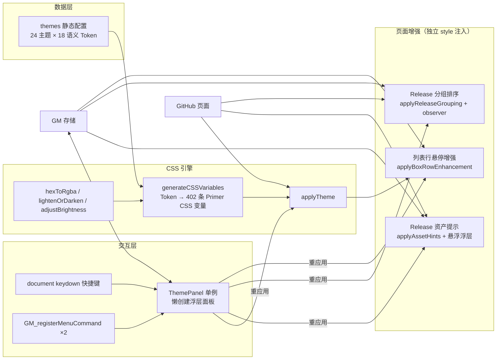
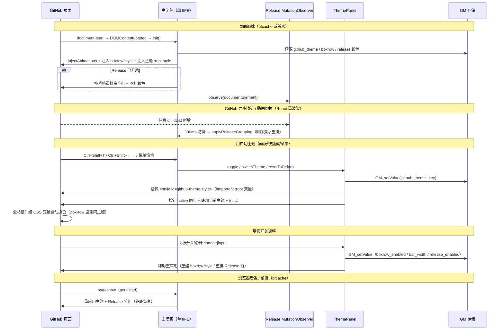

# GitHub Themes — 代码地图（MAP）

> 依据 `GithubTheme.js`（@version 1.4.0.2）实际代码整理，描述模块划分、数据流与运行时调度。代码全量内聚于单个 IIFE，无外部依赖、无网络请求。

## 1. 载体与元信息（头部注释）

| 项 | 值 | 说明 |
| --- | --- | --- |
| 运行载体 | Tampermonkey / ScriptCat 等 userscript 管理器 | 单 IIFE 主闭包，无子闭包 |
| `@match` | `*://*.github.com/*` | 仅 GitHub 全站注入 |
| `@run-at` | `document-start` | 但 `init()` 挂 `DOMContentLoaded`（见第 4 节 readyState 分支） |
| `@grant` | `GM_addStyle` / `GM_registerMenuCommand` / `GM_getValue` / `GM_setValue` | 无网络、无跨域 GM_xhr、无外部资源 |
| 状态载体 | `GM_getValue`/`GM_setValue`（每次写入即时持久化） | 6 个独立设置键（见第 2 节） |
| 主题载体 | `themes` 静态配置内嵌脚本（24 项） | 数据驱动：加主题零逻辑改动 |

## 2. 状态与存储（GM_* 键 → 内存）

> 模式：读取时 `GM_getValue(KEY, 默认)` 建内存镜像；面板/快捷键改动时先写变量 → `GM_setValue` → 调即时重应用函数。主题数据本身是静态常量，不入 GM 存储。

| 存储键 | 变量 | 默认 | 用途 / 面板控件 |
| --- | --- | --- | --- |
| `github_theme` | `ThemePanel.currentTheme` | `'default'` | 当前主题（含 `default` 还原项） |
| `github_boxrow_enabled` | —（直接 GM 读） | true | 列表行悬停增强开关 |
| `github_boxrow_bar_width` | — | 4 | 悬停竖条粗细 px（滑杆 2–16） |
| `github_release_group_enabled` | — | false | Release 分组排序开关（opt-in） |
| `github_release_hint_enabled` | — | true | Release 资产类型徽章 + 悬浮说明总开关 |
| `github_release_recommend_enabled` | — | true | 本机系统 ⭐ 标记开关（依赖上者） |

注：`applyBoxRowEnhancement()` / `applyReleaseGrouping()` 每次执行时**实时读取** GM 值而非内存镜像，保证任意入口（面板/init/observer）状态一致；`github_theme` 的镜像在 `ThemePanel` 实例内维护。

## 3. 模块总览

与 DeepSeek 工具箱的差异：主题基于 **CSS 变量覆盖**，GitHub 动态渲染的内容通过继承自动变色，因此**无需统一 MutationObserver 分流**——仅 Release 分组（DOM 重排）需要 observer，boxrow 增强纯 CSS 无 JS 状态。

## 4. 初始化与运行时事件

### 4.1 `init()` 执行序列（幂等，仅一次，DOMContentLoaded 后）

1. `injectAnimations()`：`GM_addStyle` 注入 toast 动画 keyframes。
2. `applyBoxRowEnhancement()`：默认常驻注入列表行悬停样式（读开关与粗细）。
3. `applyReleaseGrouping()` + `setupReleaseGroupingObserver()`：先按当前开关执行一次，再挂专用 observer（默认关闭时 no-op）。
4. `applyAssetHints()` + `initAssetTipEvents()`：给资产行加类型徽章与 ⭐ 标记，并绑定悬浮 / 聚焦 / 点击事件（默认开启）。
5. `new ThemePanel()`：仅构造（懒创建，不插 DOM），读取 `github_theme`。
6. `applyTheme(GM_getValue('github_theme','default'))`：恢复上次主题。
7. 注册菜单命令 ×2 + `document` 级 `keydown` 快捷键（第 5.6 节）。
8. `pageshow`（`e.persisted`）→ 重新 `applyTheme` + `applyAssetHints()`（bfcache 兜底）。

### 4.2 启动时机分支（脚本尾部）

`document.readyState === 'loading'` → 挂 `DOMContentLoaded`；否则立即 `init()`（与 `@run-at document-start` 配合，保证 DOM 就绪才注入 `:root` 变量）。

### 4.3 唯一 MutationObserver（Release 专用，非全站分流）

| 触发 | 监听范围 | 处理 | 防抖 |
| --- | --- | --- | --- |
| GitHub 异步渲染（任意 childList 变化） | `document.documentElement`，subtree | 先查 GM 开关，两者都关直接 return → `applyReleaseGrouping()` + `applyAssetHints()` | 300ms |

防自循环：重排**仅在 DOM 顺序实际改变时**执行 `appendChild`（`children.some` 对比）；开启/关闭均以首次记录的原始相对序（`ghbOrig`）为基准。

## 5. 模块内部流程

### 5.1 主题数据 → CSS 变量生成引擎

- **配置模型**（`themes`，第 55–458 行）：24 项 = 11 浅 + 12 深 + `default`（`tokens: null` + `isDefault: true`，表示不注入、还原原生）。每套主题仅声明 **18 个语义 Token**（6 行 × 3 字段）：背景层 `bgDefault/bgSubtle/bgInset/bgEmphasis`、文本 `fgDefault/fgMuted/fgSubtle/fgOnEmphasis`、语义 `accent/success/danger/warning/done`、组件 `headerBg/headerFg/codeBg/border/link`。
- **衍生值**（`generateCSSVariables` 顶部）：语义色的 `hover`（`lightenOrDarken` 0.12）、`active`（0.18）与 `-subtle`（α .12）/`-muted`（α .30）半透明族；边框 muted/subtle（α .55/.35）；按钮/控件 hover 亮度偏移（`adjustBrightness` ±4/±8，按深浅方向）；阴影、overlay、以及 Box-row 增强自用变量 `--ghb-accent-bar` / `--ghb-boxrow-hover-bg`（accent α .10/.18）。
- **三个颜色工具**：
  - `hexToRgba(hex, alpha)` — 透明派生；
  - `lightenOrDarken(bg, color, amount)` — 依**背景亮度**决定方向（暗底按 `1+amount` 提亮、亮底按 `1-amount` 压暗，"更强烈"感）；
  - `adjustBrightness(hex, amount)` — 加减固定亮度。
- **输出**：单个 `:root` 块，**402 条 Primer CSS 变量**，按 46 个注释小节组织（核心背景/文本、语义色文本与背景、边框全族、Header、Page Header、卡片、CodeMirror、Prettylights、按钮 7 态族、表单控件、Overlay/菜单/Tooltip、Label、Diff、贡献图、ANSI 终端色、Box-row 增强变量等），全面覆盖 GitHub Primer 组件体系。
- **加固**：模板字符串经正则 `^(  --[\w-]+:[^;]*);$` → `$1 !important;` **批量追加 !important**（源码 1006–1007 行），确保压过 GitHub 样式且存活 bfcache。

### 5.2 主题应用与还原（`applyTheme`）

1. 移除旧 `#github-theme-style`；
2. `default` / `tokens` 为空 → 直接返回（**恢复原生**，不留任何注入）；
3. 否则生成 CSS 并以 `<style id="github-theme-style">` 插入 `<head>`。

要点：选择 `<style>` DOM 元素而非 inline style，是为**bfcache 存活**——后退/前进时元素随 DOM 缓存保留；`pageshow(e.persisted)` 再兜底重建一次。切换主题时仅需替换这一个 style 元素，动态内容继承 `:root` 变量自动变色。

### 5.3 列表行悬停增强（纯 CSS，无状态）

- 独立 `<style id="github-boxrow-style">`（与主题 style 分离，默认开启、独立开关/粗细）：
  - `.Box-row` 强制直角（`border-radius:0`，默认主题下也生效）；
  - `:hover` → 底色 `var(--ghb-boxrow-hover-bg, #f0f6ff)` + 左侧竖条 `inset shadow var(--ghb-accent-bar, #0969da)`（宽度 = `github_boxrow_bar_width`），链接与自绘下载按钮跟随主题强调色；
  - **主题联动**：竖条/底色引用的是主题 `:root` 注入的 `--ghb-*` 变量 → 切换主题自动变色，**无需重建 style**；默认主题下走 CSS 兜底色（GitHub 原生蓝）。
- 关闭开关 → 移除 style **彻底还原**（不残留强制直角/分隔线）；滑杆 input 事件实时 `applyBoxRowEnhancement()` 重绘竖条。

### 5.4 Release 分组排序（DOM 重排，默认关闭）

- **平台判定**：`ghbAssetName(row)` 优先取下载链接 `href` basename（`decodeURIComponent`），退行取行文本；`detectPlatform(name)` 按扩展名/关键词优先级：apk/aab → android、ipa → ios、exe/msi/win*/mingw → windows、dmg/pkg/macos/osx/darwin → mac、appimage/deb/rpm/snap/linux/ubuntu → linux；`tok()` 处理 `win32` 类词边界；未命中 → `other`。
- **排序**：`PLATFORM_ORDER = [windows, mac, linux, android, ios]`（`other` rank 999 垫底）；只取含 `.octicon-package` 的 `.Box-row`，并**按父容器分组**（`byParent` Map）逐组重排，避免误动页面其它 `.Box-row`。
- **可还原**：首次见到某行时 `dataset.ghbOrig` 记录原始相对序（单调递增计数器防碰撞）——关闭开关后按 `ghbOrig` 归位，再开启不产生漂移。
- **图标着色** `colorReleaseIcon`：同系统 `.octicon-package` 图标统一 `PLATFORM_COLORS` 色（Windows 蓝 `#0078d4` / mac 银灰 `#8e8e93` / linux 橙 `#f5803e` / android 绿 `#3ddc84` / ios 靛紫 `#5e5ce6`），`!important`；关闭/未命中则移除 color 内联样式还原。
- **observer**：`documentElement` `childList+subtree`，回调内先查 GM 开关（关闭即退），300ms 防抖触发。

### 5.5 Release 资产类型提示（DOM 装饰，默认开启）

- **分类器** `classifyAsset(name)` 返回 `{ platform, arch, kind }`：
  - 元数据类（`meta: true`，弱化显示、只给图标）：`signature`（`.sig/.asc/.minisig`）、`checksum`（`SHA256SUMS`、`*.sha256/.md5/.sha1`、`checksums.txt`、`.digests`）、`sbom`（`.spdx.json/.cdx.json/.sbom.json`）、`provenance`（`.intoto.jsonl/.att.json/provenance.json`）、`symbols`（`.pdb/.dSYM.zip/.dbg/.sym/-dbgsym/.debuginfo/.ddeb`）、`updater`（`latest*.yml|json`、`.blockmap/.delta`、`.appinstaller`、`appcast.xml`）、`win-patch`（`.msu/.msp/.msm/.cab`）、`win-store-upload`（`.msixupload/.appxupload`）；
  - 主类型：`android`（apk/aab/xapk/apks/obb）、`ios`（ipa）、`win-store`（msix/msixbundle/appx/appxbundle/xap）、`win-installer`（msi 或 setup/installer/install 命名的 exe，分隔符后允许版本点号）、`win-exe`（其它 exe）、`mac-installer`（dmg/pkg/mpkg）、`linux-pkg`（AppImage/deb/rpm/snap/flatpak/pkg.tar.*/run）、`pkg-eco`（whl/jar/war/ear/nupkg/gem/phar/vsix/crx/xpi）、`firmware`（uf2/hex/elf/img/dtb/uboot）、`vm-image`（ova/ovf/vhd/vhdx/vmdk/vdi/qcow2）、`iso-image`（iso）、`script`（install|setup|bootstrap 的 sh/ps1/bat）、`docs`（pdf/epub/chm/mobi）、`archive`（zip/tar.*/tbz2/txz/tzst/tlz4/tzo/7z/rar）。
  - **色调**：每条规则带 `tone`（win/mac/linux/android/ios/portable/meta/neutral），`generateCSSVariables` 为每套主题生成明暗自适应的 `--ghb-*` 变量；徽章与悬浮层共用同一套色。压缩包识别到系统时图标换 `📦`、文案「免安装」（portable 色），否则 `🗜️`/「压缩包」。
- **架构** `describeArch(name)`：`x86_64` → Intel/AMD 64 位、`aarch64|arm64` → ARM 64、`universal2` → 通用、`i686|i386` → 32 位；无匹配返回空。
- **行内徽章**：`decorateAssetRow` 在下载链接 `a[href*="/releases/download/"]` 之后插入 `.ghb-asset-chip`（类型图标 + 短文案）；元数据类只显示图标；本机系统匹配时文案前加 `⭐`（如 `⭐ 🗜️ 免安装`），悬浮面板内显示「适合你的 <系统> 系统」。用户文案用动词短语内联回答「我该怎么用」，悬浮补「是什么 / 给谁 / 怎么装 / 替代选择」。
- **推荐** `pickRecommended(items, userPlatform)`：仅 `RECOMMENDABLE_KINDS`（安装器 / 商店包 / 包 / 压缩包，**不含商店上传包与元数据**）参与，按 kind 分组，同组有 64 位 / 通用包则只标它们；`detectUserPlatform()` 由 UA 判定（iPadOS 按触点数判 ios）。
- **悬浮浮层**：`ensureAssetTip` 挂 `body`（`position:fixed`，避免 `.Box` overflow 裁切）；`mouseover` 220ms 延迟打开、`mouseout` 120ms 延迟关闭、`focusin` 立即打开、点击切换、`Escape` / `scroll` / `resize` 关闭；浮层 `pointer-events:none`。
- **幂等**：`decorateAssetRow` 更新前比对文本 / 类 / aria，避免 MutationObserver 自循环；`removeAssetHints()` 移除徽章与浮层、还原行文本。
- **样式**：`injectAssetHintStyles()` 注入 `#github-asset-hint-style`，沿用 `--ghb-*` 主题变量，切主题自动变色。

### 5.6 交互层（ThemePanel 单例 + 快捷键 + 菜单）

- **面板生命周期**：`toggle()` → `show()`（首次 `createPanel()` 懒建并插入 body）↔ `hide()`（移 `show` 类）。打开后 100ms 自动聚焦搜索框。
- **面板结构**（`createPanel` 模板）：头部（标题 + `23 款主题` 计数（`Object.keys(themes).length - 1`）+ 搜索框 + ×）；内容区三段：浅色网格 / 深色网格 + 空状态提示、📐 列表行增强控制（开关 + 竖条粗细滑杆 2–16px + 实时值）、🗂️ Release 分组开关、🏷️ 资产类型徽章开关、⭐ 本机系统标记开关；底部（当前主题名 + 🔄 恢复默认 + `⌨️ Ctrl+Shift+T` 提示）。
- **渲染** `renderThemeButtons(filter)`：`default` **恒排最前**，其余按配置序；default/浅色 → lightGrid，深色 → darkGrid；过滤词匹配显示名或 key；某区归零隐藏该区 + 显示空状态。按钮卡片含**主题色渐变预览**（`linear-gradient(135deg, bgDefault, bgSubtle, accent)`，default 为纯白）+ key 副标题；点击有 scale 反馈。
- **切换** `switchTheme(key)`：`GM_setValue` → 更新镜像与按钮 `.active` → 更新底部当前主题 → `applyTheme` → toast。`resetToDefault()` = `switchTheme('default')` + toast。
- **搜索防抖**：`input` 200ms 防抖重渲染；`ESC` 语义分级——**有搜索词**先清词恢复完整列表并 `stopPropagation`；无词不拦截，冒泡给 document 关闭面板。
- **关闭路径**：× 按钮 / 面板外 click / `ESC`（document 级）；toast 3s 自动淡出移除（`slideUp` + `fadeOut` keyframes）。
- **增强控件即时生效**：开关 `change` 与滑杆 `input` → `GM_setValue` → 重应用函数 → toast（滑杆实时无 toast）。
- **快捷键**（document 级 keydown）：`Ctrl+Shift+T` 开/关面板；`Ctrl+Shift+←/→` 依 `Object.keys(themes)` 环形切上一/下一主题（跨 `default` 项）。
- **菜单命令**：🎨 打开主题面板 / 🔄 恢复默认主题。

## 6. 典型运行序列

